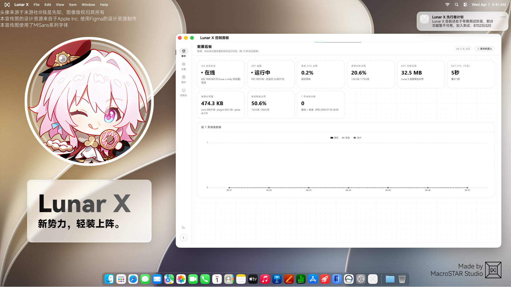

<div align="center">
  
<h1>Lunar X｜新势力，轻装上阵。</h1>
<p align="center">新一代QQ机器人框架，轻便、扩展性强，随心所欲。</p>

      


</div>

---

>[!Caution] 
>为 Lunar X 预备好。
>
>你现在正在查看的是开发预览版本！正式版将于不久之后推出。

## 加入 [Lunar X 先行者计划](https://qm.qq.com/cgi-bin/qm/qr?k=uxFoXR5MU32DgFlNcr66Hdhi2hXyb-qw&jump_from=webapi&authKey=Ov+142qleY2t+gQWr8xo6krv3NXTDg9mY8lNEWHMxgZYHPSfWQFJmo98hZ5N8aS2)

## 概览

Lunar X 是一个全新的 QQ 机器人框架，以「轻便、高效、超强拓展性」为设计理念。框架采用事件驱动的异步架构（asyncio），将协议层、连接层、插件层完全解耦，开发插件只需关注业务逻辑本身，无需接触底层协议细节。

### 核心特性

- **双协议支持**：默认使用 Milky 协议（HTTP API + WebSocket 事件通道），同时完整保留 OneBot v11 适配（WebSocket），通过 `config.json` 中 `protocol` 字段一键切换
- **轻量插件体系**：
  - 支持单文件插件与目录插件（含 `setup.py` 入口）
  - 命令触发与永久触发（`Any`）两种模式，支持优先级排序
  - 热重载：文件监控自动检测插件变更并重载，`{触发符}重载插件` 手动刷新
  - 启停即改名：插件文件名添加 `d_` 前缀即可禁用，无需修改任何配置
- **统一事件模型**：消息（私聊/群聊）、通知（撤回/禁言/戳一戳/群变动等）、请求（好友/入群/邀请）、元事件与框架生命周期事件全覆盖
- **完整的消息段体系**：文本、@、图片、表情、语音、视频、文件、引用、合并转发等消息段，另附 CQ Code 解析等工具
- **动态 API 调用**：`bot.diy.任意接口名(...)` 即可直接调用协议端任意接口，无需逐个封装
- **WebUI 管理面板**（`webui.py`）：仪表盘、实时日志控制台、插件商店（GitHub 仓库源）、配置在线编辑、Bot 进程一键重启
- **内置实用插件**：AI 对话（OpenAI 兼容接口）、群聊语录（SQLite 存储）、定时任务（重启自动恢复）、群管理（禁言/踢人/全体禁言/公告）
- **完善权限体系**：超级用户 / 管理员 / 普通用户三级权限，管理员列表可在线维护

### 项目结构

```
Lunar_X/
├── main.py            # 入口，加载配置并启动 LunarBot
├── webui.py           # Flask WebUI 管理面板
├── core/              # 框架核心
│   ├── bot.py         # 主控制器（事件分发、原生命令、发送入口）
│   ├── connection.py  # OneBot WebSocket 传输层
│   ├── transport.py   # Milky 传输层（HTTP + WebSocket）
│   ├── onebot_adapter.py # OneBot v11 协议适配器
│   ├── milky_adapter.py  # Milky 协议适配器（action/事件/消息段转换）
│   ├── events.py      # 事件模型与工厂
│   ├── message.py     # 消息段构建器与工具
│   ├── commands.py    # 命令解析（Unicode 空白、触发词）
│   ├── security.py    # 路径/ZIP/下载 URL/原子写等安全工具
│   ├── plugin_manager.py # 插件加载/热重载/监控
│   ├── plugin_config.py  # 插件私有配置 schema
│   ├── diy.py         # 动态 API 调用器
│   └── logger.py      # 彩色日志系统
├── plugins/           # 插件目录（d_ 前缀 = 已禁用）
├── static/ templates/ # WebUI 前端资源
├── tests/             # 单元测试（python -m unittest discover -s tests）
├── data/              # SQLite 数据文件
└── logs/              # 运行日志（runs/ 按运行归档）
```

## 快速开始

```bash
# 1. 安装依赖（Python >= 3.13）
uv sync --dev

# 2. 启动 WebUI（默认只监听 127.0.0.1:5000）
python webui.py
```

首次启动会自动生成 `config.json`、`webui.json` 和随机初始密码：密码会打印在控制台，
并写入 `webui.initial_password`（权限 0600）。登录后请立即在「设置 → 账户与安全」修改密码，
改密后该文件会自动删除。

```bash
# 3. 在 WebUI 的「配置」页填好协议端地址/token，
#    在「用户」页把自己的 QQ 加入 super_users（root_user=0 时没有默认管理员）
# 4. 启动 Bot
python main.py
```

## 配置与密钥

| 文件 | 内容 | 是否进仓库 |
|---|---|---|
| `config.json` | 协议端地址、token、触发词等主配置 | ❌ 已 gitignore |
| `config.example.json` | 主配置模板，可直接复制 | ✅ |
| `admin114.json` | 超级管理员 / 管理员名单 | ❌ 已 gitignore |
| `appsettings.json` | OneBot 协议端配置（含 AccessToken） | ❌ 已 gitignore |
| `webui.json` | 面板账号密码哈希、会话密钥 | ❌ 已 gitignore |
| `plugins/*/config.json` | 插件私有配置（含 API Key） | ❌ 已 gitignore |

主配置模板见 `config.example.json`（严格 JSON）或 `examples/config.example.jsonc`（带注释版）。
AI 对话等插件配置在 `plugins/<插件名>/config.json`，不在主配置里。

## 安全部署须知

- WebUI 默认只监听 `127.0.0.1`。确需远程访问时，请放在 HTTPS 反向代理后，并通过
  `LUNARX_WEB_HOST` / `LUNARX_WEB_PORT` 显式改监听地址。
- 安装插件等同于在本机执行任意 Python 代码。只从可信来源安装，并尽量核对插件的
  SHA256；不要安装来源不明的 `requirements.txt`。
- `webui.json`、`admin114.json`、插件 `config.json`、日志和 SQLite 数据库都可能包含
  敏感信息，不要提交到仓库；项目已提供 `.gitignore` 默认规则。
- 发现安全问题请先私下联系维护者，不要在公开 issue 里贴可利用细节。

## 生产部署

开发时用 `python webui.py`（Flask 内置服务器，仅本机）就够了。生产环境请用真正的
WSGI 服务器：

```bash
# 安装 WSGI 服务器
uv sync --extra serve

# Linux：Gunicorn
gunicorn -c deploy/gunicorn.conf.py wsgi:application

# 任意平台（含 Windows）：Waitress
waitress-serve --listen=127.0.0.1:5000 wsgi:application
```

仓库里 `deploy/` 目录提供了可直接改造的配置：

| 文件 | 用途 |
|---|---|
| `deploy/gunicorn.conf.py` | Gunicorn 配置（线程 worker、SSE 超时） |
| `deploy/nginx.conf.example` | Nginx 反代示例（HTTPS、SSE、登录限流） |
| `deploy/Caddyfile.example` | Caddy 反代示例（自动 HTTPS） |
| `deploy/lunarx-webui.service` | systemd 单元（WebUI，含安全加固） |
| `deploy/lunarx-bot.service` | systemd 单元（Bot） |
| `deploy/lunarx.env.example` | 环境变量模板 |

放在反代后面时，这三个环境变量必须设置：

```bash
LUNARX_TRUST_PROXY=1      # 信任 X-Forwarded-*（填反代层数，通常是 1）
LUNARX_COOKIE_SECURE=1     # 外层是 https，session cookie 必须带 Secure
LUNARX_ALLOWED_HOSTS=your.domain.com   # 限制 Host 头，防 Host 注入
```

⚠️ **没有反代时不要设 `LUNARX_TRUST_PROXY`**：客户端可以伪造 `X-Forwarded-For`，
盲目信任等于把 IP 白名单的钥匙交出去。

### 完整部署顺序

```bash
# 1. 拉代码 + 装依赖
git clone <repo> /opt/Lunar_X && cd /opt/Lunar_X
uv sync --extra serve

# 2. 用 systemd 跑（改好 unit 里的 User / WorkingDirectory / ExecStart）
sudo cp deploy/lunarx-webui.service deploy/lunarx-bot.service /etc/systemd/system/
sudo cp deploy/lunarx.env.example /etc/lunarx.env && sudo chmod 600 /etc/lunarx.env
sudo systemctl daemon-reload && sudo systemctl enable --now lunarx-webui lunarx-bot

# 3. 配反代（Nginx 或 Caddy 二选一）
sudo cp deploy/nginx.conf.example /etc/nginx/conf.d/lunarx.conf   # 改域名与证书路径
sudo nginx -t && sudo systemctl reload nginx

# 4. 首次登录：密码在 systemd 日志里，或项目根目录 webui.initial_password
sudo journalctl -u lunarx-webui -n 20
```

## 数据与隐私

- **群消息默认不记录**。需要 `$历史消息` / `$群消息统计` 时，在
  「插件管理 → tools → 配置」里开启「记录群消息」。
- 开启后消息默认保留 30 天，到期自动清理。可调「消息保留天数」，
  或用 `$清理消息 [天数|全部]` 手动清理（仅管理员）。
- AI 对话的上下文只存在内存里，重启即清空，不落盘。
- WebUI 带 CSRF token 校验、登录失败锁定、IP 白名单与会话代际失效。

## 维护脚本

| 脚本 | 用途 |
|---|---|
| `scripts/check_csp.py` | 校验页面资源与 CSP 策略是否兼容（防止加了 CSP 后白屏） |
| `scripts/purge_history_secrets.sh` | 清理 git 历史里的敏感信息（**需人工确认后执行**） |


## 插件开发文档

[插件开发文档](https://lunar.macrostar.top/) （文档还在编写中，敬请期待。）

## Contributors

[后藤一里](https://github.com/houtengyiliawa)

[](https://github.com/MacroSTAR-Org/Lunar_X/graphs/contributors)


项目为氛围编程（Vibe Coding），介意请勿使用。

## 许可证

GPL License 3.0

<div align="center">
Copyright © 2024-2026 MacroSTAR. All Rights Reserved.
</div>
